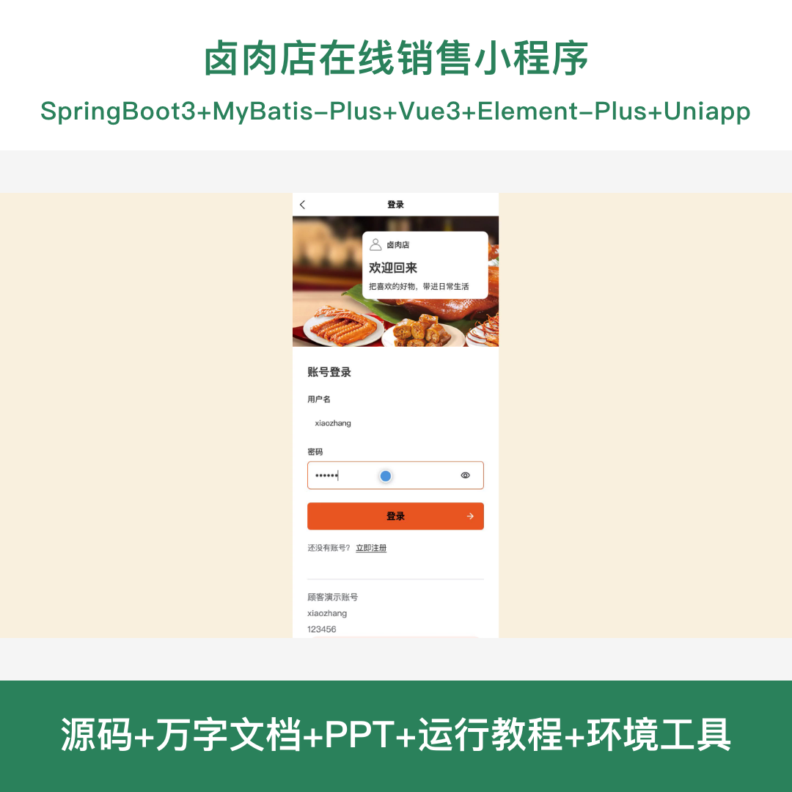
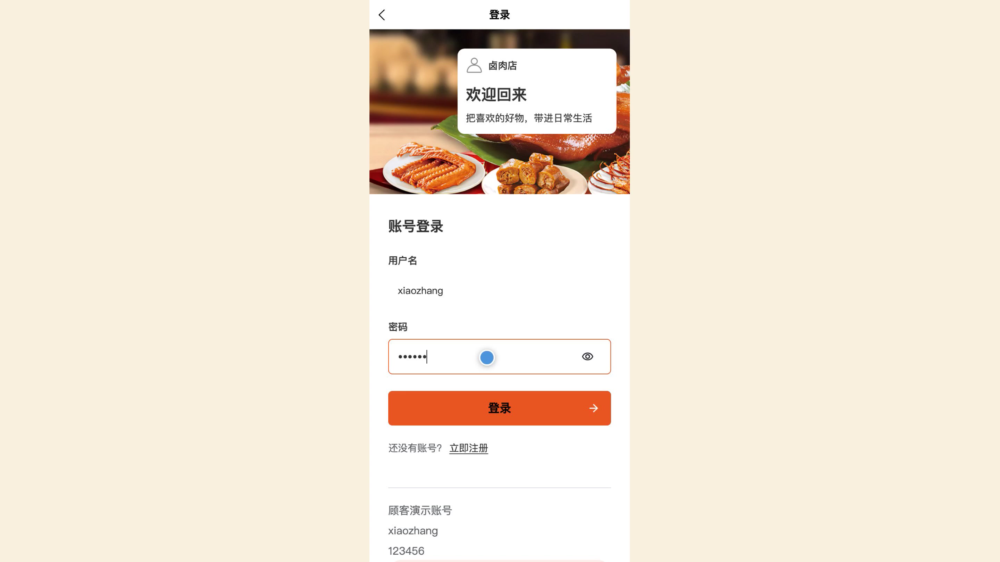
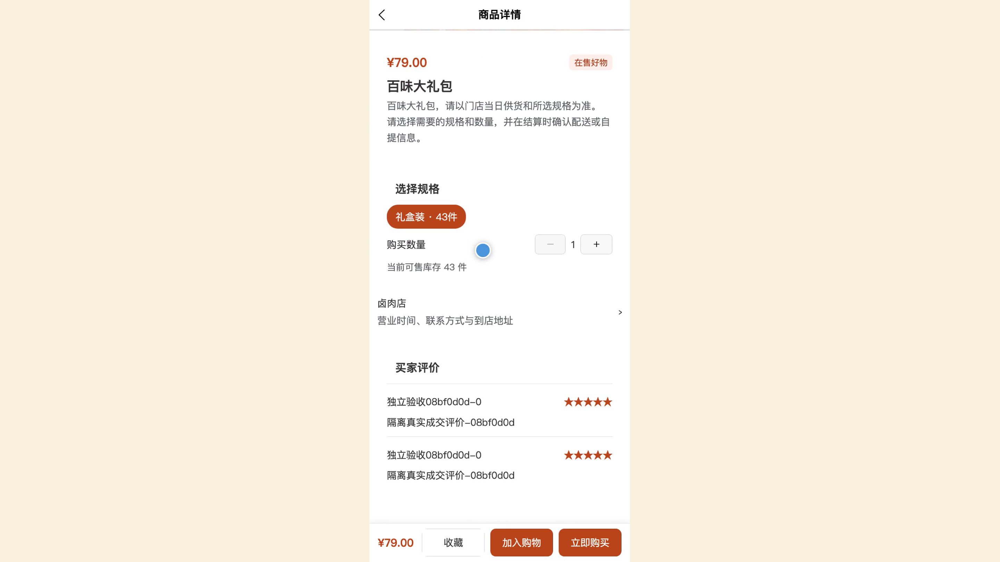
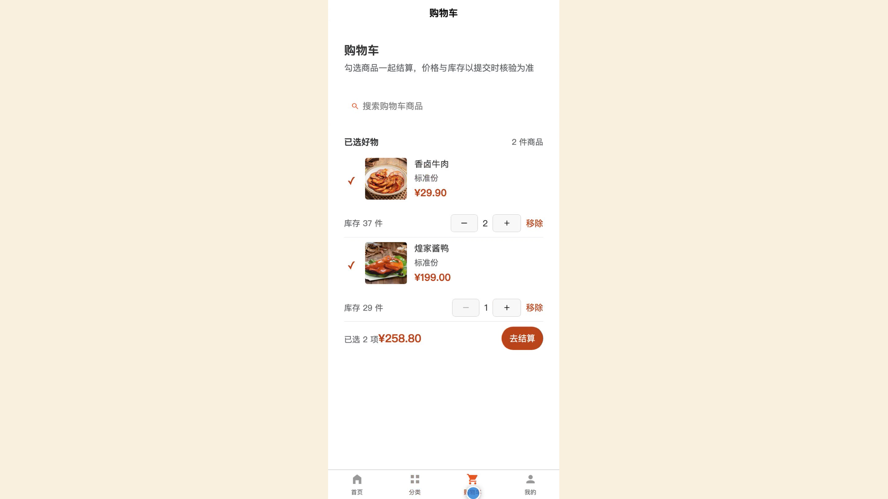
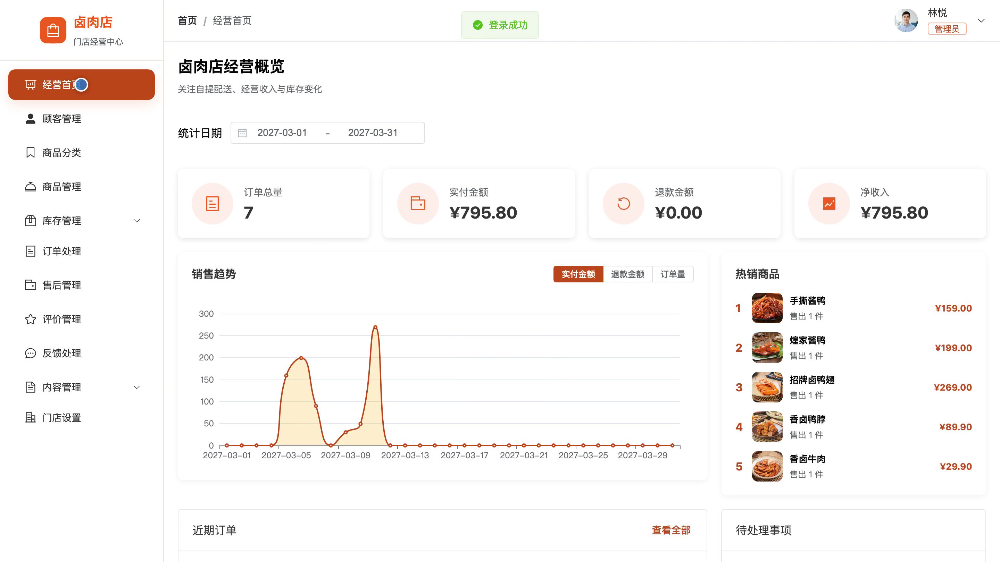
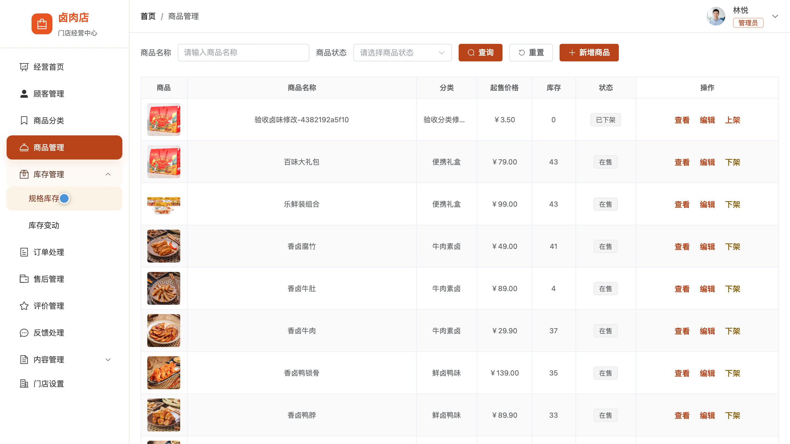
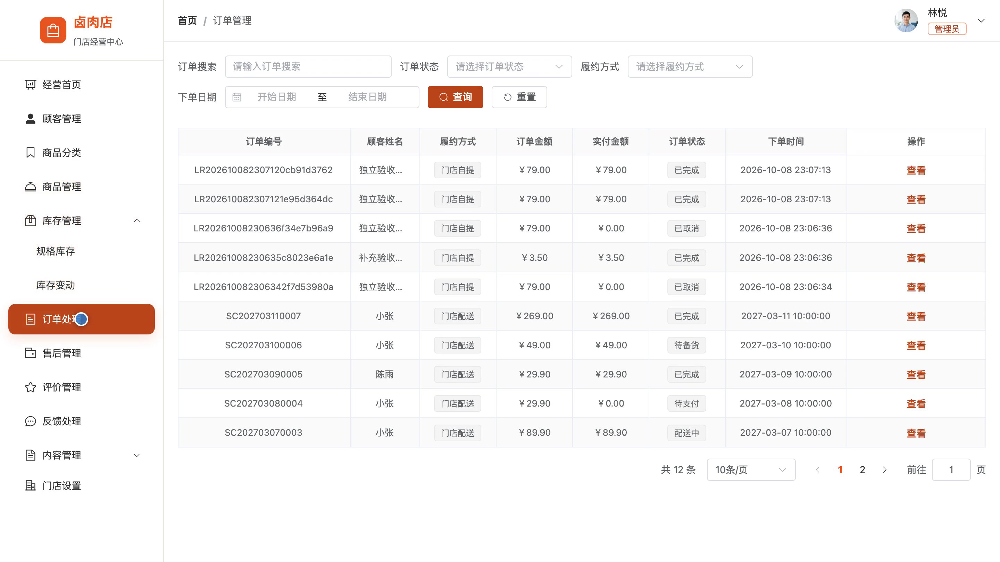
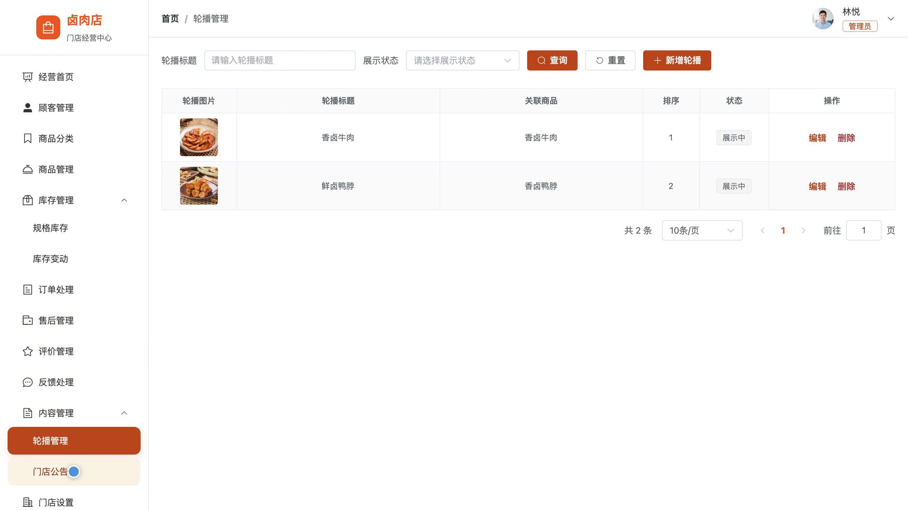

## 源码问题查看主页咨询

### 一、关键词
卤肉店、卤味销售、微信小程序、商品选购、购物车、订单配送、门店自提、整单售后

### 二、作品包含
源码+数据库+全套环境和工具资源+本地部署教程

### 三、项目技术
前端技术： Html、Css、Js、Vue3.4、Element-Plus、uniapp
后端技术：Java、SpringBoot3.2.0、MyBatis-Plus

### 四、运行环境要求
开发工具：IDEA/eclipse + VSCODE + HBuilder X + 微信开发者工具

数据库：MySQL5.7（共19张表）

数据库管理工具：Navicat10以上版本

环境配置软件： JDK17 + Maven3.6

前端Nodejs：20+

浏览器：谷歌浏览器

### 五、项目介绍
项目编号：bs158B

卤肉店在线销售小程序面向单店卤味经营。顾客通过小程序浏览商品、选择规格并下单，可选择门店自提或配送；管理员在后台维护商品、库存、订单及门店内容。

角色：顾客、管理员

顾客功能：注册登录与个人资料维护、卤味分类检索与商品详情及收藏、购物车与规格数量调整、门店自提或配送下单与模拟支付、订单进度查询与取消及收货确认、收货地址维护、商品评价与整单售后申请、门店公告浏览与意见反馈。

管理员功能：经营数据看板与销售统计、顾客账号与商品分类管理、商品及规格库存与库存记录管理、自提配送订单处理、整单售后审核与退款处理、顾客评价与意见反馈处理、门店信息和营业设置、轮播图与门店公告管理。

### 六、运行截图

